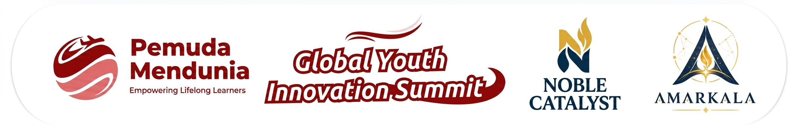

<div align="center">



# Amarkala

**Education Inclusion Ecosystem & Data Transparency**

Platform transparansi data pendidikan Indonesia: verifikasi status KIP, database sekolah, pelaporan ketimpangan bantuan, dan webinar inklusif.


</div>

---

## Tentang Amarkala

Banyak siswa yang berhak menerima bantuan pendidikan justru tidak tercatat, sementara bantuan lain jatuh ke penerima yang salah sasaran. Amarkala hadir sebagai ekosistem yang membuat data bantuan pendidikan lebih terbuka, mudah dicek, dan bisa dilaporkan oleh masyarakat.

Amarkala dikembangkan bersama **Noble Catalyst** dan **Pemuda Mendunia**, dan selaras dengan target *Sustainable Development Goals* (SDG) 4, 10, dan 17.

## Fitur

| Fitur | Fungsi |
| --- | --- |
| **Dashboard** | Ringkasan data dan statistik inklusi pendidikan |
| **KIP Tracker** | Cek status Kartu Indonesia Pintar dengan NIK atau NISN |
| **School Database** | Direktori sekolah beserta data penerima KIP |
| **Report Blindspot** | Laporan bantuan yang tidak diterima atau salah sasaran |
| **Webinar Hub** | Jadwal dan pendaftaran webinar pendidikan inklusif |
| **Komunitas** | Bergabung sebagai relawan atau anggota komunitas |
| **Partnership** | Pengajuan kemitraan untuk lembaga dan perusahaan |

## Tech Stack

- **Frontend:** React 18, TypeScript, Vite, Tailwind CSS, Lucide React
- **Backend & database:** Supabase (PostgreSQL)

## Menjalankan Secara Lokal

**Prasyarat:** Node.js 18 atau lebih baru dan sebuah project Supabase.

```bash
# 1. Clone repository
git clone https://github.com/Raisyaauliya/Amarkala.git
cd amarkala

# 2. Install dependency
npm install

# 3. Siapkan environment
cp .env.example .env
# isi VITE_SUPABASE_URL dan VITE_SUPABASE_ANON_KEY dengan milik project Supabase kamu

# 4. Jalankan migrasi database
# jalankan file SQL di folder supabase/migrations melalui SQL Editor Supabase

# 5. Jalankan aplikasi
npm run dev
```

| Perintah | Kegunaan |
| --- | --- |
| `npm run dev` | Menjalankan server pengembangan |
| `npm run build` | Membuat build produksi ke folder `dist` |
| `npm run preview` | Melihat hasil build produksi |
| `npm run lint` | Memeriksa kode dengan ESLint |
| `npm run typecheck` | Memeriksa tipe TypeScript |

## Struktur Project

```
amarkala/
├── public/                 # Logo dan aset statis
├── src/
│   ├── components/         # Navbar, Footer
│   ├── lib/supabase.ts     # Koneksi Supabase dan tipe data
│   ├── pages/              # Halaman tiap fitur
│   ├── App.tsx             # Navigasi antarhalaman
│   └── main.tsx
├── supabase/migrations/    # Skema database
└── .env.example            # Contoh konfigurasi environment
```

## Roadmap Keamanan

Amarkala sedang dikembangkan dari sisi keamanan data sebagai bagian dari Tugas Akhir di Program Studi Sistem Informasi, Universitas Siber Asia, berjudul *Pengembangan Sistem Proteksi Data Masking dan Anonimisasi Laporan pada Website Penyaluran Bantuan Pendidikan Amarkala*.

- [ ] Data masking NIK dan NISN pada tampilan dan respons API
- [ ] Pembatasan hak akses database dengan Row Level Security
- [ ] Enkripsi kolom data sensitif
- [ ] Pelaporan anonim *zero-log* dengan kode tiket
- [ ] Pembatasan jumlah pencarian (*rate limiting*)

> **Catatan:** Seluruh data penerima KIP di repository ini adalah data simulasi, bukan data asli.

## Pengembang

**Raisya Auliya Salsabila**
Program Studi Sistem Informasi, Universitas Siber Asia

---

<div align="center">
Dibuat untuk pendidikan Indonesia yang lebih inklusif.
</div>
